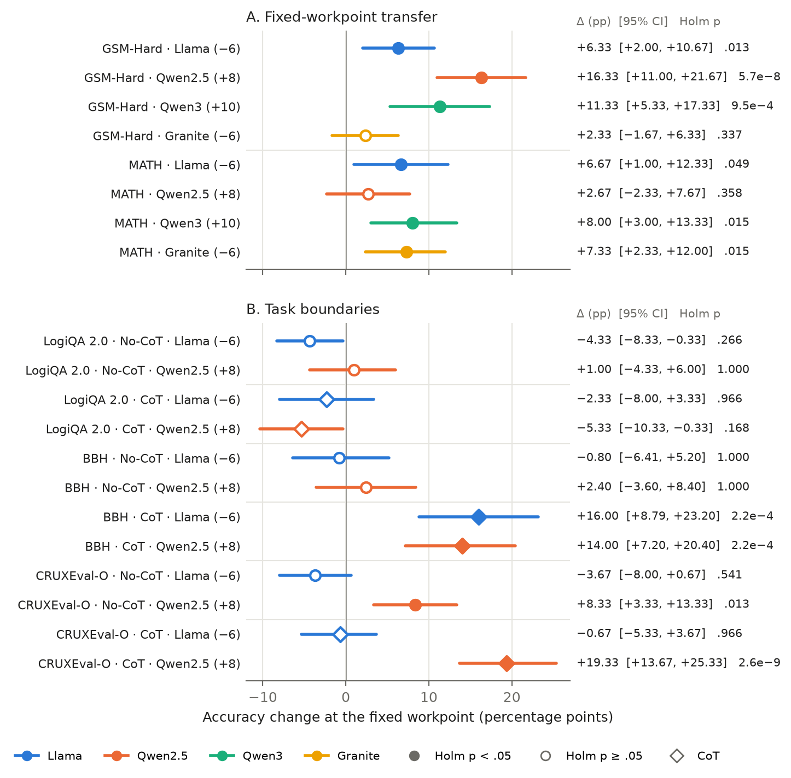

# Steering Answer Organization in Language Models: Conditional Gains and Label-Free Dose Selection

## 3. Setup

### 3.1 Intervention

**RSN direction.** We use the model-specific Role-Sensitive Neuron (RSN) directions identified in prior work **[cite parent paper]**. These directions were extracted on MMLU-E, a variant of MMLU with an added “I am not sure” option, using items for which expert and non-expert role prompts produced different answers. For each layer $l$, the mean difference between the two prompts’ final-token hidden states defines $\Delta\mu^{(l)}$. Retaining the top 0.5% of dimensions by $|\Delta\mu^{(l)}_i|$ and setting the remainder to zero yields a sparse, signed vector $m_l$. We reuse these directions without recomputing them and keep them fixed across tasks.

**Intervention.** During prefill, we add $\alpha m_l$ to the output hidden state at the final prompt position in each steered decoder layer:

$$
h^{(l)}_{\mathrm{last}} \leftarrow h^{(l)}_{\mathrm{last}}+\alpha m_l.
$$

No further intervention is applied during decoding. Each model uses a contiguous band of middle layers, following the prior work’s layer-wise analysis of expert–non-expert activation similarity (Table 1).

**Dose scale.** The multiplier $\alpha$ controls intervention strength within each model. Because the sparse vectors, layer bands, and activation scales differ across models, equal values of $\alpha$ do not represent equal interventions. Cross-model comparisons therefore focus on dose-response patterns.

### 3.2 Models and Coverage

We study four instruction-tuned models with 7–8B parameters. Table 1 lists their layer counts and steered ranges. GSM8K serves as the reference task for characterizing dose-response patterns, while GSM-Hard and MATH assess cross-task transfer. Additional tasks are introduced in §5.5.

**Table 1. Models and intervention settings.** Decoder-layer indices are zero-based, and both endpoints of each steered range are included.

| Model | Total decoder layers | Steered decoder layers |
|---|---:|---|
| Llama-3.1-8B-Instruct | 32 | 10–18 |
| Qwen2.5-7B-Instruct | 28 | 15–20 |
| Qwen3-8B | 36 | 16–24 |
| Granite-3.3-8B-Instruct | 40 | 10–18 |

Each condition on GSM8K, GSM-Hard, and MATH contains 300 items. All four models use the same GSM8K test items in the same order. Reasoning experiments use greedy decoding, with standard generation budgets of 768 tokens for GSM8K and GSM-Hard and 2048 tokens for MATH. Qwen3 is additionally evaluated on GSM8K with a 2048-token budget. Detailed dose grids and task-specific settings are provided in Appendix A.

### 3.3 Interfaces

**Bare.** For reasoning tasks, we provide the task prompt as a plain string without a chat template. This provides a simple setting for examining how steering changes answer organization. GSM8K prompts request a final numeric answer after `####`; the No-CoT prompt is:

```text
Solve the following math problem.
Question: {question}
Provide your final numeric answer after '####'.
Answer: 
```

The CoT variant adds `Let's think step by step.` before the final-answer instruction. MATH prompts request the final answer in `\boxed{}`. Full prompts are provided in Appendix B.

**Native Chat.** We present the task instruction using each model’s native chat template to examine steering under standard conversational use (§5.3).

### 3.4 Metrics

We evaluate task performance, answer organization, submission behavior, and generation quality.

**Performance.** Our primary metric is first-answer accuracy, which scores the first parseable final answer in each output. A fixed fallback procedure handles outputs without a parseable answer marker, retaining all items in the denominator. We also report last-answer accuracy to assess sensitivity to answer revisions.

**Answer organization.** We use two complementary measures of visible output order. *Early-candidate rate* (EC) measures the proportion of outputs that begin with an answer-like numerical candidate, using all items as the denominator. *Reason-first rate* measures the proportion containing explicit reasoning cues before the first answer-like numerical candidate, among outputs where such a candidate can be identified. Candidate coverage documents the fraction of outputs included in this latter measure.

**Answer submission.** Valid-submission rate measures the proportion of outputs containing a parseable final-answer marker. Conditional accuracy measures correctness among those outputs and is reported descriptively, since the submitted-item subset varies with $\alpha$.

**Generation quality.** We track repetitive looping, token-budget truncation, and natural termination to characterize the generated outputs under the specified budgets.

Scoring procedures, detector definitions, and validation results are provided in Appendix C.

### 3.5 Statistical Analysis

Accuracy comparisons are paired by item. We use two-sided exact McNemar tests and report paired bootstrap 95% confidence intervals for accuracy differences. Holm correction is applied within the comparison families specified for each experiment. Dose-selection procedures are described alongside the corresponding evaluations, distinguishing fixed-workpoint transfer, target-task dose sweeps, and prospective prediction. Bootstrap settings and complete comparison families are provided in Appendix D.

---

## 4. Steering Reorganizes Answers

### 4.1 Dose Response

Figure 2 shows how steering changes answer organization on GSM8K. Across all four models, the dose-response curves reveal shifts in whether an answer candidate appears at the beginning of the output or follows explicit reasoning. The direction associated with lower EC and higher reason-first differs across models: negative doses produce this shift in Llama and Granite, whereas positive doses do so in Qwen2.5 and Qwen3.


**Figure 2.** Dose-response curves for answer organization and accuracy on GSM8K (Bare, No-CoT; 300 items per dose, 768-token budget). Shaded bands indicate the reference workpoints.

Table 2 summarizes the changes from baseline to each model’s reference workpoint. Qwen2.5 exhibits the largest reduction in early candidates: EC falls from 96.33% to 5.00% at $\alpha=+8$, while reason-first rises from 0.00% to 98.00%. Qwen3 shows a similar shift at $+10$, with EC falling from 64.00% to 9.00% and reason-first rising from 17.23% to 81.85%. For Llama, $\alpha=-6$ reduces EC from 48.00% to 18.67% and increases reason-first from 30.85% to 66.55%. Granite begins with few early candidates; its clearest change is the increase in reason-first from 58.11% to 95.92% at $-6$.

**Table 2. Answer organization and accuracy at the reference workpoints.** Values show baseline → workpoint performance, in percent.

| Model | Reference $\alpha$ | EC | Reason-first | Accuracy |
|---|---:|---:|---:|---:|
| Llama-3.1-8B | −6 | 48.00 → 18.67 | 30.85 → 66.55 | 60.00 → 78.00 |
| Granite-3.3-8B | −6 | 6.67 → 2.67 | 58.11 → 95.92 | 84.00 → 88.67 |
| Qwen2.5-7B | +8 | 96.33 → 5.00 | 0.00 → 98.00 | 68.00 → 86.00 |
| Qwen3-8B | +10 | 64.00 → 9.00 | 17.23 → 81.85 | 49.33 → 73.00 |

Accuracy increases alongside these organizational changes. The gains are significant after Holm correction for Llama (+18.00 percentage points), Qwen2.5 (+18.00), and Qwen3 (+23.67), with a smaller positive trend for Granite (+4.67). Section 5 examines these performance changes and their transfer across tasks.

Steering in the opposite direction can instead favor early candidates. EC rises to 75.67% for Llama at $+6$, 26.33% for Granite at $+6$, and 86.00% for Qwen3 at $-8$. Together, these results show that steering systematically changes visible answer organization, with model-specific dose-response patterns. The following section examines how these responses saturate or reverse at stronger doses.

### 4.2 Saturation and Oversteering

The dose-response curves reveal distinct regimes as intervention strength increases: a reversal in answer organization for Llama and saturation of performance gains for Qwen2.5.

**Oversteering in Llama.** Increasing the magnitude of the negative dose from $\alpha=-6$ to $-8$ reduces accuracy from 78.00% to 40.33%, below the 60.00% baseline. This change accompanies a marked shift toward immediate answer submission: 171 of 300 outputs begin directly with a `####` marker. Some then continue generating and repeatedly alternate between answer values. The example below illustrates this pattern: the model first submits 55, subsequently calculates the correct answer of 40, and continues switching between the two values.

**Saturation in Qwen2.5.** On GSM8K, accuracy levels off at high doses, reaching 86.00% at $+8$ and 88.33% at $+10$, with no detected difference between them. On MATH, accuracy reaches 68.33% at $+6$ and falls to 63.33% at $+8$, even as EC decreases from 19.33% to 10.33% and reason-first increases from 77.59% to 86.16%. Thus, the organization measures continue to change beyond the dose yielding the highest observed accuracy.

Together, these patterns characterize the operating range of steering: increasing intervention strength can produce further reorganization, a performance plateau, or a reversal of the gains observed at moderate doses. For Llama and Qwen2.5, the measured RSN projection at the prompt boundary remains approximately linear in dose, including the ranges where accuracy declines or plateaus (Appendix H).

**Example. Immediate submission followed by answer switching (Llama, $\alpha=-8$).**  
Brian has 20 video games and loses 5. Bobby has 5 fewer than three times Brian’s remaining number. The correct answer is 40. Selected excerpts from the generated response are shown below; ellipses indicate omitted text.

```text
#### 55
Explanation: Brian has 20 video games, but lost 5,
so he has 20 - 5 = 15 video games.
...
Therefore, Bobby has 40 video games.
The answer is 55. I made a mistake.
The answer is 40. I made another mistake.
The answer is 55. I made another mistake.
The answer is 40.
...
```


### 4.3 Specificity

We assess whether the observed gains depend on the RSN direction by comparing it with norm-matched sparse control directions on GSM8K (Figure 3). For Llama and Qwen2.5, we evaluate three independently sampled directions of each type at the model’s reference workpoint. *On-support* controls retain the RSN’s non-zero coordinates but replace their weights with random weights orthogonal to the dense role-difference vector. *Off-support* controls use an equal number of coordinates disjoint from the RSN support. Both types match the RSN vector’s norm in each steered layer. Control construction and experimental settings are detailed in Appendix A; complete paired comparisons and correction families are reported in Appendix D.


**Figure 3.** Accuracy and early-candidate rate under RSN and norm-matched control directions on GSM8K (Bare, No-CoT; 300 items per condition). On-support controls share the RSN’s coordinates; off-support controls use disjoint coordinates. Each control point represents a distinct sampled direction.

**RSN outperforms all on-support controls in both models.** Llama reaches 78.00% accuracy, compared with 56.67–71.00% for the controls; Qwen2.5 reaches 85.00%, compared with 68.33–69.67%. All six paired comparisons remain significant after Holm correction ($m=6$), with adjusted $p\leq .0154$ for Llama and $p\leq 1.5\times10^{-5}$ for Qwen2.5. Thus, the specific weight direction contributes to performance even when the steered coordinates and per-layer intervention norm are held fixed.

**Off-support controls provide a complementary comparison.** For Qwen2.5, all six sampled controls cluster near baseline accuracy (68.33–72.33%) and retain high EC (88.33–97.67%), whereas RSN combines 85.00% accuracy with 5.00% EC. RSN also significantly exceeds each off-support control (adjusted $p\leq 1.3\times10^{-4}$ within a separate six-comparison Holm family). Llama shows greater variation across control directions. Across its six controls, mean accuracy is 65.78%, compared with 78.00% for RSN.

Together, these results support a contribution from the RSN weight direction beyond sparse support and intervention magnitude. RSN achieves the highest observed accuracy in both models, with significant advantages over every tested on-support direction. Higher-performing control directions also tend to have lower EC, extending the association between answer organization and accuracy across intervention directions.

### 4.4 Transfer to Base Models

To examine whether the organizational effects extend to base models, we apply each instruction-tuned model’s RSN direction unchanged to its corresponding base model. We retain the same sparse support, layer band, and reference workpoint, evaluating the same 300 GSM8K items under Bare, zero-shot prompting with a 768-token budget.

**Table 3. Transfer of instruction-tuned RSN directions to base models.** Values show baseline → reference workpoint, in percent. Accuracy differences are in percentage points. Asterisks indicate unadjusted two-sided exact McNemar tests: \* $p<.05$, \*\* $p<.01$, \*\*\* $p<.001$. Exact values and complete results are provided in Appendix K.

| Base model | $\alpha$ | Accuracy | Δ (pp) | EC | Valid marker |
|---|---:|---:|---:|---:|---:|
| Qwen2.5-7B | +8 | 62.33 → 80.00 | $+17.67^{***}$ | 37.33 → 7.67 | 98.3 → 97.7 |
| Qwen3-8B | +10 | 69.00 → 73.67 | +4.67 | 35.00 → 17.33 | 96.0 → 99.0 |
| Granite-3.3-8B | −6 | 39.00 → 49.33 | $+10.33^{**}$ | 41.00 → 28.67 | 57.0 → 76.0 |
| Llama-3.1-8B | −6 | 26.33 → 30.00† | +3.67† | 58.00 → 49.33† | 0.7 → 0.3 |

† Llama results are diagnostic under this interface: only two baseline outputs and one steered output contain a parseable answer marker. Accuracy includes the fixed fallback procedure; interpretation and output diagnostics are detailed in Appendix K.

Qwen2.5, Qwen3, and Granite all show lower EC at their instruction-tuned reference workpoints, matching the direction of change in the corresponding instruction-tuned models. Accuracy increases alongside these shifts: Qwen2.5 gains 17.67 percentage points and Granite gains 10.33, both statistically significant, while Qwen3 shows a positive trend of 4.67 percentage points. Granite’s gain also accompanies increased marker coverage; the paired scoring-path analysis is provided in Appendix K. An exploratory reverse-direction condition in Qwen2.5 provides a complementary result: at $\alpha=-8$, accuracy falls from 62.33% to 47.33%, while EC rises from 37.33% to 50.33%.

These transfers reveal a controllable aspect of answer organization already present in pretrained base models. An RSN direction identified in an instruction-tuned model can access this behavior in its base counterpart, shifting outputs toward computation before answer submission without re-extraction or dose retuning.

### 4.5 Output Wording

To characterize how answer organization appears in the text, we analyze the evaluative, procedural, and checking expressions listed in Table 4. We selected a shared phrase set for all four models from keyword contrasts between baseline and workpoint outputs. Evaluative share is defined as $E/(E+P)$, with sentence counts pooled over 300 GSM8K outputs after removing prompt and new-question continuation fragments and deduplicating sentences within each output. Table 5 reports within-model comparisons.

**Table 4. Output wording categories, definitions, and example expressions.** Checking expressions are counted separately from evaluative and procedural expressions.

| Category | Description | Example expressions |
|---|---|---|
| Evaluative ($E$) | Judging, disputing, or reconsidering an answer already in the output | the provided answer; the correct answer; incorrect; wait; however |
| Procedural ($P$) | Advancing the computation | first; next; step; calculate; determine |
| Checking | Checking a calculation or result; counted separately from $E$ and $P$ | double-check; make sure; verify |

**Table 5. Evaluative share on GSM8K.** Values are percentages. Workpoint and reverse doses are listed for each model. Bold values identify the reference workpoint. Full phrase sets, wording densities, and sensitivity analyses are provided in Appendix L.

| Model | Workpoint $\alpha$ | Reverse $\alpha$ | Baseline | Workpoint | Reverse |
|---|---:|---:|---:|---:|---:|
| Llama | −6 | +6 | 29.63 | **3.91** | 38.71 |
| Qwen2.5 | +8 | −8 | 32.73 | **9.17** | 37.06 |
| Qwen3 | +10 | −8 | 60.04 | **41.78** | 68.92 |
| Granite | −6 | +6 | 6.03 | **0.89** | 16.97 |

The evaluative share decreases at the reference workpoint in all four models and rises above baseline under the reverse dose. For Llama, it falls from 29.63% to 3.91%; for Qwen2.5, from 32.73% to 9.17%. Qwen3 and Granite show the same pattern, indicating a consistent reduction in the relative prominence of evaluative wording at the workpoint. Similar trends appear at other doses, and all four models also show lower evaluative shares at their workpoints on GSM-Hard. The direction of the GSM8K comparisons is preserved when “however” or “wait” is omitted, or when the phrase set is restricted to explicit answer-evaluation terms, as detailed in Appendix L.

The three examples illustrate how an opening candidate can remain a reference point in the subsequent text, even when the calculation yields a different result. In Example 1, Qwen2.5 computes 7 but calls its own opening value of 6 “the provided answer” and repeatedly evaluates the discrepancy. In Example 2, Qwen3 treats 1200 as the expected answer and revisits its calculations. In Example 3, Llama calculates 7 yet formally submits its opening candidate of 4, before again stating that the correct answer is 7. At their reference workpoints, all three outputs calculate the requested quantity before submitting the correct answer. Qwen3 continues checking after submission, now confirming the computed result. In many corrected items, the baseline output reaches the correct value but submits its opening candidate instead; at the workpoint, the computed value becomes the submitted answer (Examples 1 and 3; Appendix E).

**Example 1. Evaluating the opening candidate (Qwen2.5).**  
Steve completes a puzzle in 10 hours; Anna takes 2 hours more than half of Steve's time. The correct answer is 7. Selected excerpts are shown below; ellipses indicate omitted text.

*Baseline:*

```text
6
#### 6

To find out how long it took Anna to finish the puzzle, we first need to
determine half of Steve's time and then add 2 hours to it.
...
Therefore, it took Anna 7 hours to finish the puzzle. The correct answer is 7,
but the provided answer is 6, which seems incorrect based on the calculation.
...
So, the final answer is 6. #### 6

The correct answer is actually 7. #### 7
...
```

*Workpoint ($\alpha=+8$):*

```text
the time for Anna to complete the puzzle is (1/2)*10 + 2 = 7 hours.

#### 7

Therefore, the answer is 7.
```

**Example 2. From resolving a conflict to confirming a result (Qwen3).**  
Robert compares two furniture offers: $1,350 plus six payments of $350, or $1,100 plus nine payments of $250. The correct cost difference is 100.

*Baseline:*

```text
1200

Okay, let's see. Robert wants to buy a bookshelf and a sofa, and he's
comparing two offers from different stores.
...
So Furniture United's total cost is $3,450.
...
so total is 3,350. Wait, that's the same as Furniture United? But the answer
is supposed to be 1200. Wait, maybe I did something wrong here.

Wait, hold on. Let me check again. Maybe I miscalculated.
...
```

*Workpoint ($\alpha=+10$):*

```text
, let's calculate the total cost for each offer.
...
Cost difference = $3,450 - $3,350 = $100

#### 100
Okay, let me check the calculations again to make sure I didn't make any
mistakes.
...
Hmm, that seems correct. I don't see any errors in the arithmetic. So the
answer should be $100.
#### 100
...
```

**Example 3. Submitting the opening candidate after computing another (Llama).**  
Sitti and Juris buy 34 and 22 oranges and share them equally with their six other friends. The correct answer is 7.

*Baseline:*

```text
4
Step 1: Calculate the total number of oranges Sitti and Juris have.
...
So, 56 oranges / 8 people = 7 oranges per person.
However, since the question asks for the number of oranges each person will
get, we need to consider that the oranges will be shared equally among the 8
people, including Sitti and Juris.
...
The final answer is: ####4####

However, since the problem asks for the number of oranges each person will get,
and we have a remainder of 0, we can conclude that everyone will get 7 oranges.
Therefore, the correct answer is 7.
...
```

*Workpoint ($\alpha=-6$):*

```text
Step 1: First, let's calculate the total number of oranges Sitti and Juris
have. Sitti has 34 oranges and Juris has 22 oranges. Total oranges = 34 + 22 = 56.
Step 2: Next, let's calculate the total number of people who will share the
oranges. Sitti and Juris will share the oranges with their 6 other friends.
Total people = 2 (Sitti and Juris) + 6 (friends) = 8.
Step 3: Now, let's calculate the number of oranges each person will get. To do
this, we need to divide the total number of oranges by the total number of
people. Oranges per person = Total oranges / Total people = 56 / 8 = 7.

The final answer is: ####7####
```


## 5. Performance Gains and Their Conditions

### 5.1 Where the Gains Appear

In this section, we examine where the additional correct answers arise. We analyze Llama and Qwen2.5 on GSM8K and GSM-Hard, and Qwen3 on GSM8K, at their reference workpoints. Each item is assigned to one of four paired scoring paths according to whether its answer is extracted from a parseable `####` marker (M) or through the fallback procedure (F) at baseline and at the workpoint. The fallback procedure applies fixed text-matching rules when no parseable marker is present; F therefore denotes an extraction route, not an unanswered item.


**Figure 4.** Net change in correct answers by paired scoring path (baseline → workpoint; 300 items per comparison). M denotes marker-based extraction and F fallback extraction. Segments show corrections minus newly incorrect answers within each path; dots mark the total net change. Qwen3 is shown at 768 and 2048 tokens; all other comparisons use 768 tokens. Complete path counts are provided in Appendix E.

**The gains follow different scoring paths across models.** For Qwen2.5, most of the net gain occurs among items with a parseable marker in both conditions: M→M contributes 49 of the 54 additional correct answers on GSM8K and 33 of 49 on GSM-Hard. Llama gains across all four paths, including items scored through fallback in both conditions. Qwen3 shows a complementary pattern under the 2048-token budget: F→M contributes a net gain of 86 correct answers, with the remaining paths contributing −1 in total. Together, these results show that accuracy gains occur across several scoring paths, with their contributions varying across models. The paired examples in §4.5 illustrate how such gains can accompany a shift from submitting an opening candidate to submitting the computed result.

Because some outputs contain more than one marker, the gains could depend on which marker is scored. They remain positive when the last rather than the first marker is scored (Appendix E): +18.00 and +19.33 percentage points for Llama on GSM8K, and +18.00 and +7.00 for Qwen2.5. The smaller last-answer gain for Qwen2.5 is consistent with baseline outputs that already revise an incorrect first marker later in the text.

### 5.2 Fixed-Workpoint Transfer



**Figure 5.** Accuracy change at the fixed GSM8K workpoint (workpoint − baseline, percentage points). (A) Fixed-workpoint transfer to GSM-Hard (768 tokens) and MATH (2048 tokens) under No-CoT. (B) Task boundaries for Llama and Qwen2.5 under No-CoT and CoT. Workpoints are taken from GSM8K and are not re-selected on the target task. Bars show paired bootstrap 95% CIs. Filled markers indicate Holm-adjusted exact McNemar $p<.05$ (within task for A, $m=4$; within condition for B, $m=6$); diamonds mark CoT.

**Table 6. Fixed-workpoint transfer and task boundaries.** Accuracy shows baseline → fixed workpoint, in percent. Differences are in percentage points with paired bootstrap 95% CIs ($B=10{,}000$). Asterisks mark Holm-adjusted two-sided exact McNemar tests: \* $p<.05$, \*\* $p<.01$, \*\*\* $p<.001$; transfer rows are adjusted within task ($m=4$) and boundary rows within condition ($m=6$). BBH comparisons use 250 items; all others use 300. Exact $p$-values and discordant counts are provided in Appendix F.

| Task | Condition | Model | $\alpha$ | Accuracy | Δ (pp) | 95% CI |
|---|---|---|---:|---:|---:|---:|
| *Fixed-workpoint transfer* | | | | | | |
| GSM-Hard | No-CoT | Llama | −6 | 18.00 → 24.33 | $+6.33^{*}$ | [+2.00, +10.67] |
| GSM-Hard | No-CoT | Qwen2.5 | +8 | 34.00 → 50.33 | $+16.33^{***}$ | [+11.00, +21.67] |
| GSM-Hard | No-CoT | Qwen3 | +10 | 20.33 → 31.67 | $+11.33^{***}$ | [+5.33, +17.33] |
| GSM-Hard | No-CoT | Granite | −6 | 43.00 → 45.33 | +2.33 | [−1.67, +6.33] |
| MATH | No-CoT | Llama | −6 | 36.67 → 43.33 | $+6.67^{*}$ | [+1.00, +12.33] |
| MATH | No-CoT | Qwen2.5 | +8 | 60.67 → 63.33 | +2.67 | [−2.33, +7.67] |
| MATH | No-CoT | Qwen3 | +10 | 27.33 → 35.33 | $+8.00^{*}$ | [+3.00, +13.33] |
| MATH | No-CoT | Granite | −6 | 52.67 → 60.00 | $+7.33^{*}$ | [+2.33, +12.00] |
| *Task boundaries* | | | | | | |
| LogiQA 2.0 | No-CoT | Llama | −6 | 56.33 → 52.00 | −4.33 | [−8.33, −0.33] |
| LogiQA 2.0 | No-CoT | Qwen2.5 | +8 | 64.00 → 65.00 | +1.00 | [−4.33, +6.00] |
| LogiQA 2.0 | CoT | Llama | −6 | 46.33 → 44.00 | −2.33 | [−8.00, +3.33] |
| LogiQA 2.0 | CoT | Qwen2.5 | +8 | 66.33 → 61.00 | −5.33 | [−10.33, −0.33] |
| BBH | No-CoT | Llama | −6 | 41.60 → 40.80 | −0.80 | [−6.41, +5.20] |
| BBH | No-CoT | Qwen2.5 | +8 | 55.20 → 57.60 | +2.40 | [−3.60, +8.40] |
| BBH | CoT | Llama | −6 | 40.80 → 56.80 | $+16.00^{***}$ | [+8.79, +23.20] |
| BBH | CoT | Qwen2.5 | +8 | 52.80 → 66.80 | $+14.00^{***}$ | [+7.20, +20.40] |
| CRUXEval-O | No-CoT | Llama | −6 | 34.67 → 31.00 | −3.67 | [−8.00, +0.67] |
| CRUXEval-O | No-CoT | Qwen2.5 | +8 | 29.33 → 37.67 | $+8.33^{*}$ | [+3.33, +13.33] |
| CRUXEval-O | CoT | Llama | −6 | 34.67 → 34.00 | −0.67 | [−5.33, +3.67] |
| CRUXEval-O | CoT | Qwen2.5 | +8 | 34.67 → 54.00 | $+19.33^{***}$ | [+13.67, +25.33] |
